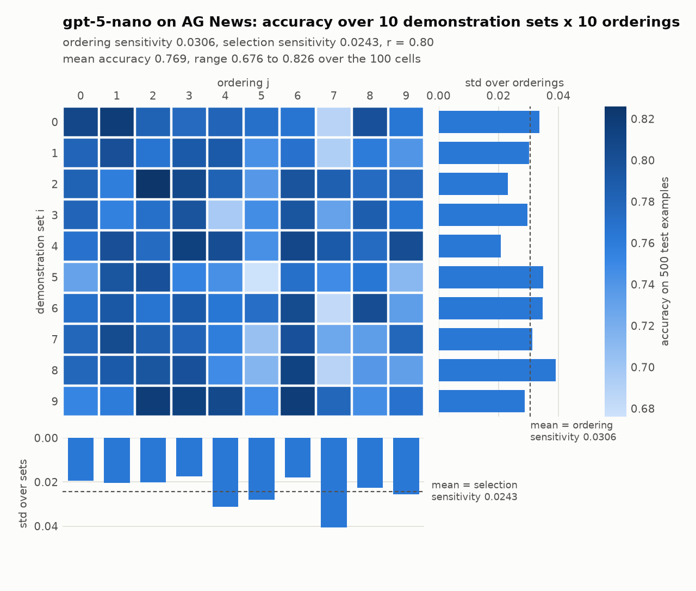

# Order vs selection in in-context learning: one cell, replicated

Replication of one cell of **"Order Matters: Rethinking Prompt Construction in In-Context Learning"**
(Li, Wang, Wang, Shang; [arXiv:2511.09700](https://arxiv.org/abs/2511.09700), November 2025), for a
course project checkpoint: **GPT-5-nano on AG News**, at the paper's full grid.

The paper's question: in a few-shot prompt, does *which* examples you show matter more than *what
order* you show them in? It measures both as standard deviations of accuracy over a grid of
M demonstration sets x P random orderings and reports their ratio r = selection / ordering.
r < 1 means the order moves accuracy more than the choice of examples.

## Result

GPT-5-nano, AG News, M = 10 demonstration sets x P = 10 orderings x 500 test examples (50,000 prompts).

| | Ours | Paper (Table 4) |
|---|---|---|
| Ordering sensitivity | **0.0306** | 0.0379 |
| Selection sensitivity | **0.0243** | 0.0303 |
| r = selection / ordering | **0.80** | 0.80 |
| Mean accuracy | 0.769 | not reported |

The ratio matches to two decimals and the direction is the paper's: for this model on this task,
ordering matters more than selection. Both of our sensitivities are about 80% of the paper's;
[REPORT.md](REPORT.md) section 5 says why. Accuracy ranged from 0.676 to 0.826 across the 100 prompt
constructions, and the worst ordering lost to the best one in every one of the 10 demonstration sets.



Run facts: 50,000 requests, 22.4 M input tokens, $1.28 at list prices, 19 minutes with 24 parallel
requests. 0.5% of replies named no label (counted wrong) and 0.5% said "Science" for the Sci/Tech
class (accepted). Every reply is cached, so rerunning the grid reproduces these exact numbers at no cost.

Full write-up: [REPORT.md](REPORT.md). Every choice the paper leaves unstated: [METHODS.md](METHODS.md).

## Where to find things

Four short modules, two scripts, one plotting script, about 700 lines in all. Read them in this order.

| Question | File | Lines |
|---|---|---|
| Where do the test examples and demonstrations come from, how are the 10 sets drawn? | [`iclorder/dataset.py`](iclorder/dataset.py) | 125 |
| How is the prompt built, what is the default ordering, how are the 10 orderings drawn? | [`iclorder/prompts.py`](iclorder/prompts.py) | 65 |
| How is the model called, how is its reply turned into a label, how is everything cached? | [`iclorder/openai_scorer.py`](iclorder/openai_scorer.py) | 239 |
| The two sensitivity formulas and r (paper Eqs. 1-3) | [`iclorder/metrics.py`](iclorder/metrics.py) | 24 |
| The experiment loop: sets x orderings x test examples, and what gets saved | [`scripts/run_sensitivity.py`](scripts/run_sensitivity.py) | 111 |
| Download AG News and write the data files | [`scripts/build_splits.py`](scripts/build_splits.py) | 30 |
| Draw the figure above | [`scripts/plot_grid.py`](scripts/plot_grid.py) | 107 |
| Our numbers | [`results/gpt-5-nano__ag_news/`](results/gpt-5-nano__ag_news/) | |
| Tests: formulas, sampling, prompt text, label reading, cache, retries (fake API client, no key) | [`tests/`](tests/) | |

What is in the result folder:

| File | Contents |
|---|---|
| `summary.json` | settings, ordering / selection / r / mean accuracy, API usage, estimated cost, run time |
| `acc.csv` | the 10 x 10 accuracy grid; row = demonstration set, column = ordering |
| `demo_sets.json` | the ids (rows of the AG News train split) of the 8 examples in each demonstration set |
| `perms.json` | the 10 orderings, as permutations of the default (label-grouped, alphabetical) order |
| `accuracy_grid.png` | the figure above |

Not in the repo: `data/` (35 MB, rebuilt by one command, seeded, byte-identical) and
`results/openai_cache/gpt-5-nano.sqlite` (14 MB, the 50,000 raw replies). Ask us for the cache if you
want to recompute the grid without an API key.

## How the measurement works

1. **Data.** 500 test examples from the AG News test split, 125 per class. Demonstrations come from
   the 120,000 training articles. Both seeded.
2. **Demonstration sets.** M = 10 sets of k = 8 examples, 2 per class, drawn without replacement.
3. **Orderings.** The paper's default ordering groups a set by label, labels alphabetical, articles
   alphabetical within a label. P = 10 distinct random permutations of the 8 positions are drawn once
   and applied to every set.
4. **Prompt.** Eight `Article: ... / Topic: <label>` blocks, then the test article and `Topic:`. Sent to
   the API as the user message, with one system line: reply with exactly one of World, Sports,
   Business, Technology.
5. **Grid.** Accuracy a[i, j] of set i under ordering j on the 500 test examples.
6. **Sensitivities.** Ordering = mean over sets of the std over orderings. Selection = mean over
   orderings of the std over sets. r = selection / ordering.

## Reproduce

Setup (Python 3.11 or newer):

```bash
python3 -m venv .venv && .venv/bin/pip install -r requirements.txt
```
```bash
.venv/bin/python -m pytest -q
```
```bash
.venv/bin/python scripts/build_splits.py
```

The second command runs 25 tests with no network and no key. The third downloads AG News (about
30 MB) and writes `data/ag_news/`.

Key: an OpenAI **API** key with a few dollars of credit (a ChatGPT subscription is not API credit).
Either export it, or on macOS store it once in the Keychain and the code finds it there:

```bash
export OPENAI_API_KEY=sk-...
```
```bash
security add-generic-password -a "$USER" -s icl-order-replication-openai -w
```

Smoke run first (64 requests, under a cent, a few seconds), then the paper's grid:

```bash
.venv/bin/python scripts/run_sensitivity.py --M 2 --P 2 --n-test 16 --tag smoke
```
```bash
.venv/bin/python scripts/run_sensitivity.py --workers 24
```
```bash
.venv/bin/python scripts/plot_grid.py
```

The full grid is 50,000 requests of about 520 tokens each. At list prices for `gpt-5-nano` ($0.05 per
million input tokens, $0.40 per million output) it costs about $1.30 and takes about 20 minutes with
24 parallel requests, which stayed under a new account's rate limits. Watch the smoke run's
"replies named no label" count: a high number means the label words or the completion budget need
attention, not the model.

Two things to know before comparing numbers:

- **Pin `gpt-5-nano`**, the August 2025 model the paper used. Newer nano models are different models.
- **GPT-5 models accept no temperature setting**, so a fresh run is not bit-reproducible: expect
  numbers close to ours, not equal. Our own rerun is exact because every reply is cached in
  `results/openai_cache/`; an interrupted run resumes from the cache for free.
