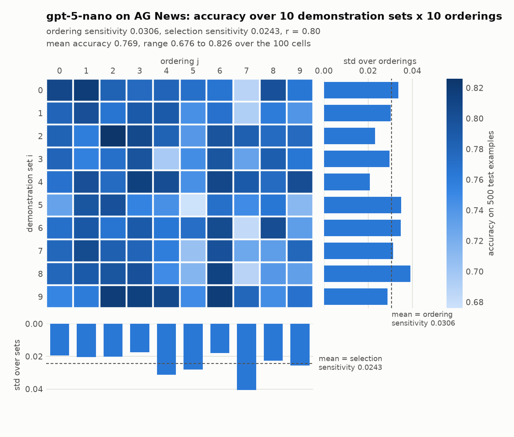

# Replicating one cell of "Order Matters: Rethinking Prompt Construction in In-Context Learning"

Replication report for arXiv:2511.09700 (Li, Wang, Wang, Shang, November 2025).
Course project checkpoint. Team: *[names]*. Course: *[course]*. Date: *[date]*.

**Summary.** We replicate one cell of the paper's Section 3 at its full size: GPT-5-nano on AG News,
10 demonstration sets x 10 orderings x 500 test examples, 50,000 prompts. The paper reports ordering
sensitivity 0.0379, selection sensitivity 0.0303 and r = 0.80 for this cell. We measure 0.0306, 0.0243
and r = 0.80. The ratio agrees to two decimals and the direction is the paper's: for this model on this
task, the order of the demonstrations moves accuracy more than the choice of demonstrations. Both
sensitivities come out about 20% smaller than the paper's; Section 5 gives the most likely reason. The
run took 19 minutes and $1.28 of API credit. Every API reply is cached, so the grid recomputes to the
same numbers without a key. Code, data recipe, the run folder and this report are in one repository.

## 1. In-context learning

A large language model can perform a task it was never fine-tuned for if the prompt shows it a few
worked examples first. This is **in-context learning (ICL)**, or few-shot prompting: the prompt is k
*demonstrations*, each an input with its answer, followed by the test input, and the model's
continuation is read as the prediction. No weights change. For a four-way news classification task,
an 8-shot prompt looks like

```
Article: <news text>
Topic: Sports

Article: <news text>
Topic: Business

... (6 more)

Article: <test news text>
Topic:
```

and the prediction is the label the model writes next.

ICL is how most practitioners adapt a model: it needs no training data pipeline, no GPU for training,
and it works through an API. Its weakness is that the result depends on how the prompt was built. Two
choices are known to move accuracy by several points: **which** examples are shown (selection) and the
**order** they are shown in (ordering). Earlier work found that some orderings of the same examples are
near state of the art and others near chance (Lu et al., 2022), that models favour labels that appear
late in the prompt or often (Zhao et al., 2021), and that retrieving examples similar to the test input
helps (Liu et al., 2022; Rubin et al., 2022). Most of that work treats selection as the main lever and
ordering as noise to be calibrated away.

## 2. Why this paper, and why we want its result

The paper asks a plain question: **is ordering really the smaller effect?** It measures both on the
same footing. For a model and a dataset it draws M = 10 demonstration sets and P = 10 random orderings
and evaluates every pair on 500 test examples, giving an accuracy grid a[i, j]. Then

- **ordering sensitivity** = mean over sets i of the standard deviation of a[i, :] over orderings;
- **selection sensitivity** = mean over orderings j of the standard deviation of a[:, j] over sets;
- **r** = selection sensitivity / ordering sensitivity. r > 1 means selection matters more.

Across 15 models and 7 datasets the paper finds the two are of the same size: selection 0.0225 against
ordering 0.0197 on average, r = 1.09 on classification and 1.46 on generation. Ordering is not noise;
it is roughly half the prompt-construction effect. The paper then shows that ordering is cheap to
exploit: score a few dozen random orderings of a fixed demonstration set on a small dev set and keep
the best, and most of the oracle's test accuracy is recovered with no retriever and no training.

We want this result for two reasons. First, if it holds, it changes how we would build prompts for any
project: spend a dev set on ordering before spending effort on example retrieval. Second, the paper
releases no code, no prompt template and no sampling procedure, so a replication is also a test of
whether the claim survives someone else's reasonable choices. A claim that only holds under one
unstated template is a weaker claim.

## 3. How we make it work

### 3.1 What we run, and why this cell

The checkpoint requirement is one model on one dataset. We chose **GPT-5-nano on AG News** at the
paper's full Section 3 grid, for three reasons.

- **It is the paper's exception.** GPT-5-nano has the lowest r in the paper's Table 2 (0.85) and the
  text singles it out as the model where ordering matters more than selection. On AG News its Table 4
  cell is ordering 0.0379, selection 0.0303, r = 0.80. A cell with a specific, non-default direction to
  get right is a sharper test than a cell that sits near the average.
- **It needs no GPU.** The model is reached through the OpenAI API. AG News is a four-way task with
  short articles, so an 8-shot prompt is about 520 tokens and the whole cell costs about a dollar.
- **The target is exact.** The paper prints this cell's two sensitivities, so there is a number to hit,
  not only a sign.

### 3.2 The pipeline

Each step is one function in the repository; the README's file table says where.

1. **Data.** AG News from the Hugging Face hub (`fancyzhx/ag_news`). The test set is 500 examples from
   the test split, 125 per class, drawn with a fixed seed. A 1,000-example dev set is drawn the same way
   so the data recipe matches the paper's split sizes; this experiment does not use it. Demonstrations
   come from the 120,000 training articles.
2. **Demonstration sets.** M = 10 sets of k = 8 examples, two per class, drawn without replacement and
   distinct from each other.
3. **Orderings.** The paper's default ordering groups a set by label, labels alphabetical, articles
   alphabetical within a label. P = 10 distinct permutations of the 8 positions are drawn uniformly at
   random, once, and the same 10 are applied to every set, which is what the paper's a[i, j] notation
   implies.
4. **Prompt.** Eight `Article: ... / Topic: <label>` blocks separated by blank lines, then the test
   article and `Topic:`. The label words are World, Sports, Business and Technology (AG News's fourth
   class is named Sci/Tech; we use one word).
5. **Model call.** One chat completion per (set, ordering, test example). The prompt is the user
   message. One system line says the user message is a sequence of labelled examples followed by an
   unlabelled one and asks for exactly one of the four labels and nothing else. Reasoning effort is set
   to minimal and the completion budget to 64 tokens. GPT-5 models accept no temperature setting, so
   decoding is the API's default. Up to 24 requests run in parallel.
6. **Label reading.** The prediction is the first allowed label word mentioned in the reply, as a whole
   word, ignoring case and punctuation. "Science", "Sci Tech" and "Tech" are accepted for Technology. A
   reply that names no label counts as wrong and is tallied.
7. **Metrics.** a[i, j] is the accuracy of set i under ordering j on the 500 test examples. Ordering
   sensitivity is the mean over i of the population standard deviation over j; selection sensitivity is
   the mean over j of the standard deviation over i; r is their ratio.
8. **Caching.** Every reply is stored in a local sqlite file under a hash of the model, the reasoning
   effort, the system line, the prompt and the budget. A rerun or a resumed run reads from the cache,
   so it costs nothing and gives the same grid.

### 3.3 Choices the paper leaves open

The paper states the metric and the grid sizes but not the prompt template, the label words, how the
label is read off, the demonstration pool, how dev and test were sampled, the seeds, or how GPT-5-nano
was called. Each is a decision we had to make; `METHODS.md` lists all of them with the code location.
The ones most likely to move numbers:

| Detail | Our choice |
|---|---|
| Template | `Article: <text>` / `Topic: <label>` per demonstration, blank line between, query ends with `Topic:` |
| Label words | World, Sports, Business, Technology |
| How the model is called | chat completion; a system line restricts the reply to the four label words; the prompt is the user message; reasoning effort minimal; default decoding |
| Label reading | first label word in the reply; Science accepted for Technology; no label counts as wrong |
| Demonstration sets | 2 per class without replacement, from the train split; 10 distinct sets |
| Test set | 125 per class from the test split, seeded |
| Orderings | 10 distinct uniform permutations of the default (label-grouped, alphabetical) order, shared across sets |
| Standard deviation | population (ddof = 0); sample std would scale both sensitivities by 1.054 and leave r unchanged |

### 3.4 Verification

- **25 unit tests**, run with a fake API client and no key: the two formulas on hand-computed grids,
  balanced sampling with and without oversampling, demonstration-set sampling (2 per class, distinct,
  seeded), the default ordering, permutation generation, the exact prompt text, the label-matching rules
  including aliases and whole-word matching, cache hits across scorer instances, retry on rate limits,
  the larger-budget retry, cost accounting and key lookup.
- **A smoke run** (2 sets x 2 orderings x 16 examples, 64 requests) before spending, to check the
  "no label" count and the reasoning-token count (both 0).
- **After the run:** the data files were rebuilt from scratch and compared byte for byte (identical),
  and the whole 10 x 10 x 500 grid was recomputed with an invalid API key so that any cache miss would
  fail: 50,000 cache hits, zero requests, and the same grid, orderings and example ids to the last bit.

## 4. Result

GPT-5-nano on AG News, M = 10, P = 10, 500 test examples.

| | Ours | Paper (Table 4) |
|---|---|---|
| Ordering sensitivity | **0.0306** | 0.0379 |
| Selection sensitivity | **0.0243** | 0.0303 |
| r = selection / ordering | **0.80** | 0.80 |
| Mean accuracy | 0.769 | not reported |



Reading the grid: each row is a demonstration set, each column an ordering, each cell the accuracy of
that prompt construction on the same 500 test articles. Accuracy ranges from 0.676 to 0.826, a 15-point
spread on a four-way task from prompt construction alone. The spread along a row (the right-hand bars,
0.021 to 0.039) is what ordering does to a fixed set of examples; the spread down a column (the bottom
bars, 0.018 to 0.041) is what changing the examples does under a fixed ordering. The best ordering
averages 0.793 over the ten sets and the worst 0.731, and the worst ordering loses to the best in every
one of the ten sets. The best demonstration set averages 0.788 and the worst 0.749, a smaller gap.

Run facts, from `summary.json`: 50,000 requests, 22.4 million input tokens, 413 thousand output tokens,
zero hidden reasoning tokens, zero retries, $1.28 at list prices, 19.3 minutes with 24 parallel
requests. 238 replies (0.5%) named no label and count as wrong; 247 replies (0.5%) said "Science" for
the Sci/Tech class and were accepted.

## 5. Discussion

**The cell replicates.** The paper reports ordering 0.0379, selection 0.0303, r = 0.80. We measure
0.0306, 0.0243, r = 0.80. The direction is the paper's, and it is the paper's unusual direction: for this
model on this dataset, which examples are shown matters less than the order they are shown in. The
ratio agrees to two decimals; each sensitivity is about 80% of the paper's value.

**Why the magnitudes are lower.** The paper does not state its template, its label words, or how it
read GPT-5-nano's answer. Our system line restricts the reply to the four label words, which likely
makes predictions steadier across prompt constructions than a free-form answer parsed afterwards. A
narrower answer space lowers both standard deviations and leaves their ratio alone, which is the
pattern we see. Two smaller effects go the same way: the API's default decoding adds per-example noise
that is shared by every cell of the grid, and our label word for Sci/Tech drew the answer "Science" in
0.5% of replies, which we accept. Parsing is not where the gap comes from: only 0.5% of replies named
no label. The binomial noise floor of a 500-example accuracy near 0.77 is 0.019, so both of our
sensitivities sit well above what sampling noise alone would produce.

**What this does and does not test.** The paper's headline, selection at least as large as ordering
on average, is a statement over 15 models and 7 datasets. One GPT-5-nano cell tests the paper's
exception to that headline, and confirms it. It does not test the headline itself, and it does not test
the paper's Section 4 claim that the best of P random orderings on a dev set recovers over 98% of the
oracle test accuracy.

**Limits.** One cell. Decoding through the API is not deterministic, so a fresh run from scratch would
give numbers close to ours, not equal; we did not measure that run-to-run spread, which would cost
another $1.28 per repeat. Every unstated choice in `METHODS.md` is ours, and the system line in
particular is a choice the paper may not have made.

## 6. Reproducing this report

```bash
python3 -m venv .venv && .venv/bin/pip install -r requirements.txt
.venv/bin/python -m pytest -q                                                    # 25 tests, no key
.venv/bin/python scripts/build_splits.py                                         # downloads AG News
export OPENAI_API_KEY=sk-...                                                     # or the Keychain entry, see README
.venv/bin/python scripts/run_sensitivity.py --M 2 --P 2 --n-test 16 --tag smoke  # 64 requests
.venv/bin/python scripts/run_sensitivity.py --workers 24                         # 50,000 requests, ~$1.30, ~20 min
.venv/bin/python scripts/plot_grid.py                                            # the figure
```

The run folder `results/gpt-5-nano__ag_news/` holds `summary.json` (settings, metrics, API usage,
cost), `acc.csv` (the grid), `perms.json` (the exact orderings) and `demo_sets.json` (the exact example
ids), so the cell can be recomputed from the data files. With our reply cache (not in the repository,
14 MB) it recomputes exactly and for free.

## References

- Li, W., Wang, Y., Wang, Z., Shang, J. (2025). Order Matters: Rethinking Prompt Construction in
  In-Context Learning. arXiv:2511.09700.
- Lu, Y., Bartolo, M., Moore, A., Riedel, S., Stenetorp, P. (2022). Fantastically Ordered Prompts and
  Where to Find Them: Overcoming Few-Shot Prompt Order Sensitivity. ACL.
- Zhao, Z., Wallace, E., Feng, S., Klein, D., Singh, S. (2021). Calibrate Before Use: Improving Few-Shot
  Performance of Language Models. ICML.
- Liu, J., Shen, D., Zhang, Y., Dolan, B., Carin, L., Chen, W. (2022). What Makes Good In-Context
  Examples for GPT-3? DeeLIO Workshop.
- Rubin, O., Herzig, J., Berant, J. (2022). Learning to Retrieve Prompts for In-Context Learning. NAACL.
- Brown, T. et al. (2020). Language Models are Few-Shot Learners. NeurIPS.
