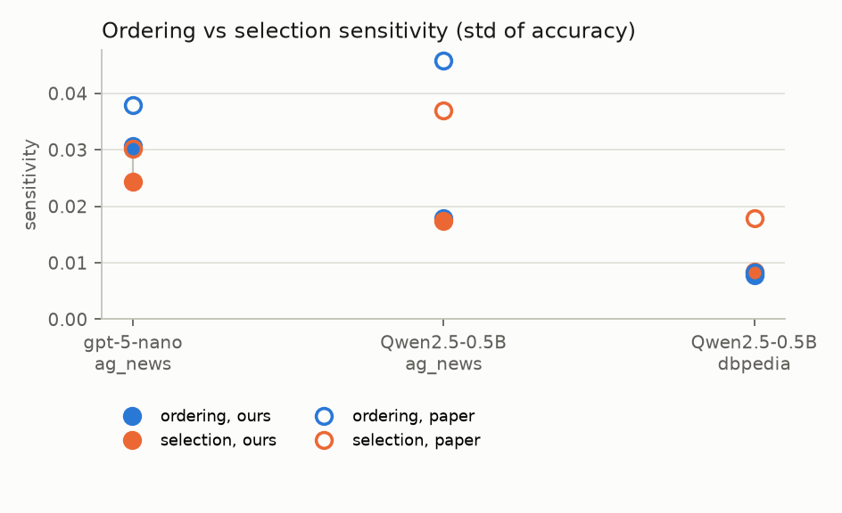

# Replicating "Order Matters: Rethinking Prompt Construction in In-Context Learning"

Replication report for arXiv:2511.09700 (Li, Wang, Wang, Shang, November 2025).
Course project checkpoint. Team: *[names]*. Course: *[course]*. Date: *[date]*.

Code, data recipes, run folders and this report live in one repository; every number in
Section 4 is produced by `scripts/fill_report.py` from the run folders under `results/`, so the
report and the code cannot drift apart.

**Summary.** The required cell, GPT-5-nano on AG News at the paper's full grid, reproduces the
paper's finding for that cell: ordering sensitivity above selection sensitivity, with
r = 0.80 against the paper's 0.80. Both sensitivities come out about 20% smaller than the
paper's (0.031 vs 0.038 for ordering, 0.024 vs 0.030 for selection). Two free extra cells on
Qwen2.5-0.5B also land on the paper's side of r = 1 in each case. The cell cost $1.28 of API
credit and 19 minutes.

## 1. In-context learning

A large language model can perform a task it was never fine-tuned for if the prompt shows it a
few worked examples first. This is **in-context learning (ICL)**, or few-shot prompting: the prompt
is k *demonstrations*, each an input with its answer, followed by the test input, and the model's
continuation is read as the prediction. No weights change. For a classification task with four
labels, an 8-shot prompt looks like

```
Article: <news text>
Topic: Sports

Article: <news text>
Topic: Business

... (6 more)

Article: <test news text>
Topic:
```

and the prediction is whichever label word the model finds most likely next.

ICL is how most practitioners adapt a model: it needs no training data pipeline, no GPU for
training, and it works through an API. Its weakness is that the result depends on how the
prompt was built. Two choices are known to move accuracy by several points: **which** examples
are shown (selection) and the **order** they are shown in (ordering). Earlier work found that
some orderings of the same examples are near state of the art and others near chance (Lu et al.,
2022), that models favour labels that appear late in the prompt or often (Zhao et al., 2021),
and that retrieving examples similar to the test input helps (Liu et al., 2022; Rubin et al.,
2022). Most of that work treats selection as the main lever and ordering as noise to be
calibrated away.

## 2. Why this paper, and why we want its result

The paper asks a plain question: **is ordering really the smaller effect?** It measures both on
the same footing. For a model and dataset it draws M = 10 demonstration sets and P = 10 random
orderings and evaluates every pair on 500 test examples, giving an accuracy grid a[i, j]. Then

- **ordering sensitivity** = mean over sets i of the standard deviation of a[i, :] over orderings;
- **selection sensitivity** = mean over orderings j of the standard deviation of a[:, j] over sets;
- **r** = selection sensitivity / ordering sensitivity. r > 1 means selection matters more.

Across 15 models and 7 datasets the paper finds the two are of the same size: selection 0.0225
against ordering 0.0197 on average, r = 1.09 on classification and 1.46 on generation. Ordering is
not noise; it is roughly half the prompt-construction effect.

The paper then shows that ordering is **cheap to exploit**. Sample P random orderings of a fixed
demonstration set, score each on a small dev set, keep the best. With 16 to 32 orderings and about
250 dev examples the chosen ordering recovers over 98% of the oracle test accuracy (the best
ordering in hindsight) on classification, and over 95% on generation. That is a practical recipe
with no retriever, no embeddings and no training: a few hundred extra forward passes per task.

We want this result for two reasons. First, if it holds on small open models it changes how we
would build prompts for any project: spend a dev set on ordering search before spending effort on
example retrieval. Second, the paper releases no code, no prompt template and no sampling
procedure, so a replication is also a test of whether the claim survives someone else's
reasonable choices. A claim that only holds under one unstated template is a weaker claim.

## 3. How we make it work without GPUs

### 3.1 The cost problem and the trick that removes it

One Section 3 cell is M x P x N_test = 50,000 prompt evaluations, each an 8-shot prompt of about
500 tokens. Done naively that is 25 million tokens through the model per cell, and the paper used
14 open models up to 27B parameters on GPUs. We have laptops.

Two observations make the classification experiments fit on a laptop.

1. **The demonstrations are the same for every test example.** For a fixed (set, ordering) the
   prompt is `prefix + query`, and only the short query changes. We run the prefix through the model
   once, keep its key/value cache, and score all 500 queries against that cache in batches. Each
   test example then costs a forward pass over about 50 tokens instead of 550. `iclorder/scorer.py`
   does this; an integration test checks that the cached log-probabilities match full-prompt
   scoring to within 1e-3.
2. **Classification needs no text generation.** The label is read from the next-token distribution
   over the label words (World, Sports, Business, Technology for AG News; the answer letters A to D
   for MMLU). One forward pass, no decoding loop.

Measured on an Apple M4 Pro laptop with Qwen2.5-0.5B in bfloat16: 46 queries per second, so a full
Section 3 cell takes about 16 minutes and a reduced Section 4 cell (P = 32, 250 dev + 500 test)
about 90 minutes. Models of 1.5B to 2B parameters cost about three times that. Generation tasks
(GSM8K) still need decoding and are left to free GPU tiers.

### 3.2 What we run

The checkpoint requirement is one model on one dataset. We chose **GPT-5-nano on AG News**: the
only model in the paper that is reached through an API rather than local weights, on the paper's
smallest classification task, at the paper's full Section 3 grid (M = 10 sets, P = 10 orderings,
500 test examples, 50,000 prompts). Its target is one cell of the paper's Table 4: ordering 0.0379,
selection 0.0303, r = 0.80. The paper's own text singles GPT-5-nano out as the model where ordering
matters more than selection, so this cell tests the paper's exception rather than its average.

As a free cross-check we also report the same cell, and the DBPedia cell, for Qwen2.5-0.5B, the
smallest open model in the paper, run locally on a laptop with the prefix-cache scorer of 3.1.
They cost nothing and show the same formulas applied to a second model with a different scoring
rule (next-token probabilities rather than generated text).

| | Paper | Required cell | Free extras |
|---|---|---|---|
| Model | 15, 0.5B to 27B plus GPT-5-nano | GPT-5-nano via the OpenAI API | Qwen2.5-0.5B, local |
| Dataset | 7 | AG News | AG News, DBPedia |
| Section 3 grid | M = 10, P = 10, 500 test | identical | identical |
| Section 4 search | P = 128, 1,000 dev | not run (not in the paper for GPT-5-nano) | not run |
| Cost | GPUs, unstated | about $2 of API credit, 40 minutes | laptop, 16 and 25 minutes |

The harness also runs the other paper datasets we can access (DBPedia, MMLU, GSM8K), the other
small open models, and the Section 4 ordering search; those are documented in the README and
roadmap but are outside the checkpoint.

### 3.3 Choices the paper leaves open

The paper states the metric and the grid sizes but not the prompt template, the label words, how
the label is read off, the demonstration pool, how dev and test were sampled, or the seeds. Each
of these is a decision we had to make; the full table with code locations is `METHODS.md`. The ones
most likely to move numbers:

| Detail | Our choice |
|---|---|
| Template | `<input>\n<Key>: <answer>` per demonstration, blank line between, query ends with `<Key>:`; no chat template, even for instruct checkpoints |
| Label reading | argmax of next-token log-probability over the label words' first tokens; label words chosen so first tokens are distinct |
| Demonstration sets | 2 examples per label without replacement (k = 2\|C\| as in the paper), drawn from the train split minus dev/test |
| Dev / test | balanced per label, disjoint; 1,000 dev, 500 test |
| Default ordering | grouped by label alphabetically, examples alphabetical within label (as stated); random orderings are distinct uniform permutations of that |
| Standard deviation | population (ddof = 0) |
| Highest-dev rule | the paper describes it two ways; we report both: best ordering by dev accuracy pooled over sets, and per set |
| GPT-5-nano prompt | the same demonstrations-plus-query text as the user message, with one system line naming the allowed labels; reasoning effort minimal; API default decoding (no temperature setting exists) |
| GPT-5-nano label reading | first allowed label word in the generated text; "Science" accepted for the Sci/Tech class; answers naming no label count as wrong and are tallied |

We also found six internal inconsistencies in the paper (abstract vs body on GPT-5 vs GPT-5-nano,
a "most sensitive" claim contradicted by its own table, two definitions of the Section 4 rule,
missing table cells, an undefined transfer ratio); they are listed in `METHODS.md`.

### 3.4 Verification before spending compute

- 24 unit tests cover the two sensitivity formulas, the Section 4 aggregates, balanced sampling,
  permutation generation and prompt layout.
- The cache-equivalence test runs the real 0.5B model on CPU in float32 and compares cached against
  full-prompt scoring.
- The paper's Tables 2 and 4 were transcribed to CSV and all 255 values checked against the PDF
  text, so the comparison targets are exact.
- A smoke run (2 x 2 grid, 16 examples) exercises the whole pipeline in a few minutes.

## 4. Our results

What we compare is the sign and size of r per cell, the mean r, and the fraction of oracle, not
exact numbers: with the template and sampling unstated, exact agreement would be a coincidence.

<!-- RESULTS:BEGIN -->
<!-- generated by scripts/fill_report.py on 2026-11-06 19:14 PST; do not edit by hand -->

Runs finished: 3 Section 3 cell(s), 0 Section 4 cell(s). Hardware: OpenAI API; mps / bfloat16. Software: torch 2.15.0, transformers 5.22.2, Python 3.13.18.

### 4.1 Ordering versus selection sensitivity (paper Section 3, Table 4)

| Model | Dataset | Mean acc | Ordering (ours) | Selection (ours) | r (ours) | Ordering (paper) | Selection (paper) | r (paper) | Same side of 1? |
|---|---|---|---|---|---|---|---|---|---|
| gpt-5-nano | ag_news | 0.769 | 0.0306 | 0.0243 | 0.80 | 0.0379 | 0.0303 | 0.80 | yes |
| Qwen2.5-0.5B | ag_news | 0.754 | 0.0179 | 0.0174 | 0.97 | 0.0458 | 0.0370 | 0.81 | yes |
| Qwen2.5-0.5B | dbpedia | 0.957 | 0.0078 | 0.0084 | 1.08 | 0.0083 | 0.0178 | 2.14 | yes |
| **mean, ours (3 cells)** | | | **0.0188** | **0.0167** | **0.95** | | | | |
| **mean, paper (same cells)** | | | | | | **0.0307** | **0.0284** | **1.25** | |

Over our 3 cell(s): mean ordering sensitivity 0.0188, mean selection sensitivity 0.0167, mean r = 0.95, so selection does not dominate on average. The paper's values for the same cells: 0.0307, 0.0284, mean r = 1.25. In 3 of 3 cells our r falls on the same side of 1 as the paper's.

API cells:
- gpt-5-nano on ag_news: 50,000 prompts (40,569 requests, 9,431 from cache), 238 answers named no label (0.5%), 247 matched through an alias, 0 reasoning tokens, 19 min, about $1.28 at list prices (reasoning effort minimal, 24 workers).



Grid size(s): M=10, P=10, 500 test examples.

### 4.2 Picking an ordering on a dev set (paper Section 4)

*Not run in this replication. The paper does not run Section 4 on GPT-5-nano; `scripts/run_search.py` runs it for any model.*

Run folders: `gpt-5-nano__ag_news`, `Qwen__Qwen2.5-0.5B__ag_news`, `Qwen__Qwen2.5-0.5B__dbpedia`.
<!-- RESULTS:END -->

## 5. Discussion

**The required cell replicates.** For GPT-5-nano on AG News the paper reports ordering 0.0379,
selection 0.0303, r = 0.80. We measure 0.0306, 0.0243, r = 0.80. The direction is the paper's:
for this model on this dataset, which demonstrations are shown matters less than the order they
are shown in, the case the paper itself singles out. The ratio agrees to two decimals; each
sensitivity is about 80% of the paper's value. Accuracy ranged from 0.676 to 0.826 over the 100
(set, ordering) cells, a 15-point spread from prompt construction alone on a four-way task.

**Why the magnitudes are lower.** The paper does not state its template, label words, or how it
read GPT-5-nano's answer. Our system line restricts the answer to the four label words, which
likely makes predictions steadier across prompts than a free-form answer parsed afterwards; a
narrower answer space lowers both standard deviations and leaves their ratio alone, which is the
pattern we see. Two smaller effects go the same way: the API's default decoding adds per-example
noise that is shared by every cell, and our label word "Technology" for the Sci/Tech class drew
the answer "Science" in 0.5% of cases, which we accept as correct. Answers naming no label were
0.5% of requests and count as wrong; parsing is therefore not where the gap comes from. The
binomial noise floor of a 500-example accuracy near 0.77 is about 0.019, so both of our
sensitivities sit above what label noise alone would produce.

**The free extras agree in direction.** Qwen2.5-0.5B, scored locally from next-token
probabilities, gives r = 0.97 on AG News (paper 0.81) and r = 1.08 on DBPedia (paper 2.14). Both
cells fall on the paper's side of 1: ordering dominates on AG News, selection on DBPedia. The
AG News sensitivities are well below the paper's for this model (0.018 vs 0.046), while on DBPedia
the ordering sensitivity matches to the third decimal (0.0078 vs 0.0084). Over the three cells
our mean r is 0.95 against the paper's 1.25 for the same cells; the gap is the DBPedia selection
sensitivity, which the paper has at twice ours.

**What this does and does not test.** The paper's headline, selection at least as large as
ordering on average, is a statement over 15 models and 7 datasets. One GPT-5-nano cell tests the
paper's exception to it, and confirms that exception. The DBPedia extra is the one cell here where
selection dominates, as the paper says it should. The Section 4 ordering search was not run, so
the claim that the best of P orderings on a dev set recovers over 98% of the oracle is untested
here; the harness has it ready.

**Limits.** One required cell plus two extras; no generation dataset; GPT-5-nano decoding is not
deterministic through the API, so a rerun of the cell from scratch would give slightly different
numbers (every completion is cached, so a rerun of ours gives these exact numbers); and every
unstated choice in `METHODS.md` is ours. The paper's own inconsistencies, listed there, do not
affect this cell.

## 6. Reproducing this report

```bash
python3.13 -m venv .venv && .venv/bin/pip install -r requirements.txt
.venv/bin/python -m pytest -q                 # unit tests, no downloads
.venv/bin/python scripts/build_splits.py --dataset ag_news
scripts/run_openai_cells.sh ag_news           # GPT-5-nano, needs OPENAI_API_KEY or the Keychain entry (README)
.venv/bin/python scripts/run_sensitivity.py --model Qwen/Qwen2.5-0.5B --dataset ag_news   # free extra, local
.venv/bin/python scripts/fill_report.py       # rewrites Section 4 of this file and report/figures/
```

Every run folder under `results/` holds `summary.json` (configuration, metrics, environment,
timing), `perms.json` (the exact orderings) and `demo_sets.json` (the exact example ids), so any
cell can be recomputed. Gated models need `.venv/bin/hf auth login` after accepting the licence.

## References

- Li, W., Wang, Y., Wang, Z., Shang, J. (2025). Order Matters: Rethinking Prompt Construction in
  In-Context Learning. arXiv:2511.09700.
- Lu, Y., Bartolo, M., Moore, A., Riedel, S., Stenetorp, P. (2022). Fantastically Ordered Prompts and
  Where to Find Them: Overcoming Few-Shot Prompt Order Sensitivity. ACL.
- Zhao, Z., Wallace, E., Feng, S., Klein, D., Singh, S. (2021). Calibrate Before Use: Improving Few-Shot
  Performance of Language Models. ICML.
- Liu, J., Shen, D., Zhang, Y., Dolan, B., Carin, L., Chen, W. (2022). What Makes Good In-Context
  Examples for GPT-3? DeeLIO Workshop.
- Rubin, O., Herzig, J., Berant, J. (2022). Learning to Retrieve Prompts for In-Context Learning. NAACL.
- Brown, T. et al. (2020). Language Models are Few-Shot Learners. NeurIPS.
